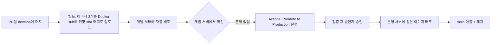

# 배포 가이드

개발 서버와 운영 서버에 배포하는 방법과, 새 서버를 연결하는 방법을 정리한 문서다.
배포는 모두 GitHub Actions가 하고, 서버에는 SSH로 접속해서 Docker Compose로 올린다.

## 1. 한눈에 보기



- **개발 서버**: `develop`에 머지하면 **자동**으로 배포된다.
- **운영 서버**: 사람이 **직접** 승격한다. 개발 서버에서 검증한 것과 **같은 이미지**(같은 커밋 sha)를 올리고, 다시 빌드하지 않는다.
- `main` 브랜치는 "운영에 승격한 **가장 앞선** 커밋"을 가리킨다. **현재 운영 상태를 뜻하지는 않는다**(과거 커밋으로 롤백해도 `main`은 뒤로 가지 않는다). 무엇이 언제 배포됐는지는 `prod-날짜-sha` 태그가 기록하고, 현재 운영에 올라가 있는 커밋은 (태그 기록이 성공했다면) 가장 최근의 태그로 확인한다. 태그 기록이 실패한 경우의 확인 방법은 8장.

이 문서가 다루는 것은 **API 서버**(`team-project-api.kgudevelopers.monster`, 개발은 `api.dev.kgudevelopers.monster`)다. 프론트엔드(`team-project.kgudevelopers.monster`)는 Cloudflare Pages로 서버와 따로 배포되며 이 문서와 무관하다. 프론트 주소는 서버 설정에서 CORS 허용 주소로만 등장한다(4장).

## 2. 환경과 워크플로

| 구분 | 이름 | 역할 |
|---|---|---|
| GitHub Environment | `cloud-dev` | 개발 서버 접속 정보. 이미지 빌드 job도 이 환경을 쓴다 |
| GitHub Environment | `cloud-prod` | 운영 서버 접속 정보. **첫 승격 전에 승인자를 지정해야 한다**(9장) |
| 워크플로 | `cloud-dev-build-deploy.yml` | `develop` push마다 빌드하고 개발 서버에 배포 |
| 워크플로 | `deploy-reusable.yml` | 서버 배포 스크립트 본체. 개발·운영이 함께 쓴다 |
| 워크플로 | `promote-to-production.yml` | 검증된 커밋을 운영 서버에 승격(수동 실행) |
| 워크플로 | `server-preflight.yml` | 서버가 배포할 준비가 됐는지 점검(수동 실행, 읽기 전용) |

환경마다 **같은 시크릿 이름**에 서버별 값을 넣는다. 워크플로가 `environment`로 어느 환경을 쓸지 정하면 그 환경의 값이 쓰인다.

## 3. GitHub Environment 시크릿

`cloud-dev`와 `cloud-prod` 모두에 아래 6개가 있어야 한다.

| 이름 | 값 | 예 |
|---|---|---|
| `SERVER_HOST` | 서버 IP 또는 도메인 | `43.203.37.52` |
| `SERVER_PORT` | SSH 포트 | `22` |
| `SERVER_USERNAME` | SSH 접속 사용자 | `ubuntu` |
| `SSH_PRIVATE_KEY` | 접속용 개인키(pem) **전체 내용**. `-----BEGIN`줄부터 `-----END`줄까지 | |
| `DOCKER_COMPOSE_YAML_PATH` | 서버 안의 compose 폴더(절대 경로) | `/home/ubuntu/aics-team-project-server` |
| `ENVIRONMENT_PATH` | 서버 안의 `.env` 파일(절대 경로) | `/home/ubuntu/aics-team-project-server/.env` |

`cloud-dev`에는 위 6개에 더해 **이미지 빌드용 2개**가 필요하다. 빌드 job이 `cloud-dev` 환경을 쓰기 때문이다. 서버를 바꿔도 이 두 값은 그대로 둔다.

| 이름 | 값 |
|---|---|
| `DOCKERHUB_USERNAME` | Docker Hub 사용자명 |
| `DOCKERHUB_PASSWORD` | Docker Hub **액세스 토큰**(계정 비밀번호가 아님) |

시크릿 값은 GitHub에서 한 번 저장하면 다시 볼 수 없다. 서버 주소·사용자·경로와 Docker Hub 계정 정보는 **본인이 따로 보관**해 두자(개인키 파일 포함).

**환경 변수(Variables)**: 배포 스크립트의 스모크 테스트가 호출할 공개 도메인은 환경의 변수 `PUBLIC_API_HOST`로 정한다. 없으면 운영 API 도메인(`team-project-api.kgudevelopers.monster`)을 쓰므로, **개발 서버 환경(`cloud-dev`)에는 개발 API 도메인을 반드시 지정**해야 한다. 지정하지 않으면 개발 배포가 운영 API 도메인을 검사한다.

## 4. 서버 준비 체크리스트

새 서버(또는 처음 연결하는 서버)에서 아래를 갖춘다.

- [ ] Docker와 Docker Compose 플러그인 설치
- [ ] 접속 사용자가 `sudo` 없이 `docker`를 쓸 수 있음(`sudo usermod -aG docker $USER` 후 재접속)
- [ ] **SSH 포트가 GitHub Actions에서 접속 가능**: 보안그룹(방화벽)이 해당 포트를 모든 IP에 허용해야 한다. GitHub 러너의 IP는 계속 바뀌어서 특정 IP만 허용하면 접속이 안 된다
- [ ] 서버에서 인터넷(Docker Hub)에 접근 가능
- [ ] compose 폴더가 **미리 만들어져** 있음(배포 첫 단계가 이 폴더로 이동한다): `mkdir -p <DOCKER_COMPOSE_YAML_PATH>`
- [ ] `.env` 파일이 준비됨(아래 키 참고), 권한은 `chmod 600`
- [ ] 80, 443 포트가 **다른 스택에 점유되지 않았고** 외부에서 열려 있음(Caddy가 HTTPS를 처리한다). 같은 서버에 다른 compose 스택이 이 포트를 쓰고 있으면 배포가 포트를 잡지 못한다
- [ ] 서비스 API 도메인의 DNS가 이 서버를 가리킴

`docker-compose.yml`, `Caddyfile`, `pgadmin-servers.json`은 **배포 때 저장소에서 자동으로 복사**되므로 서버에 직접 만들지 않는다. 서버에서 고쳐도 다음 배포에 덮어써진다.

**서버에서만 쓰는 compose 설정**은 같은 폴더의 `docker-compose.override.yml` 하나에만 둔다.
- 배포는 이 파일이 있으면 확인·pull·기동·롤백의 **모든** compose 명령에 똑같이 붙인다(`-f docker-compose.yml -f docker-compose.override.yml`). 그래서 확인한 설정과 실제로 뜨는 설정이 같다.
- 승격의 이미지 확인도 override를 반영한 결과로 하므로, override가 앱 이미지를 바꾸면 승격이 서버를 바꾸기 전에 멈춘다.
- override는 배포가 관리하지 않아 성공 기록(`.releases`)에 들어가지 않는다. 롤백할 때도 지금 서버의 override를 그대로 쓴다.
- `compose.yaml`, `compose.yml`, `docker-compose.yaml`, `compose.override.*`, `docker-compose.override.yaml`처럼 compose가 대신 읽을 수 있는 다른 이름의 파일이 폴더에 있으면 어떤 설정이 쓰일지 모호하므로 배포가 멈춘다(서버는 바뀌지 않는다).

### `.env`에 필요한 키

이 저장소의 `docker/development/docker-compose.yml`에서 읽은 목록이다. 점검 워크플로(5장)가 같은 기준으로 확인해 준다.

**필수(없으면 배포가 실패한다)**

| 키 | 설명 |
|---|---|
| `POSTGRES_DB`, `POSTGRES_USER`, `POSTGRES_PASSWORD` | 데이터베이스 |
| `PGADMIN_DEFAULT_EMAIL`, `PGADMIN_DEFAULT_PASSWORD` | pgAdmin 로그인 |
| `JWT_SECRET_KEY`, `JWT_ISSUER` | 인증 토큰 |
| `FILE_SECRET_KEY` | 파일 처리 |
| `AWS_S3_BUCKET` | 파일 저장소(S3) 버킷 이름 |
| `DOCKERHUB_USERNAME` | 이미지 이름 앞부분(`사용자명/aics-api:태그`). 이미지 저장소는 공개라 서버에서 `docker login`은 필요 없다 |

**S3 자격 증명(둘 중 하나)**: `AWS_S3_ACCESS_KEY`와 `AWS_S3_SECRET_KEY`를 **둘 다** 넣거나, **둘 다 비워 두고 서버(EC2)에 IAM 역할을 연결**한다. 앱은 키가 비어 있으면 서버의 IAM 역할로 S3에 접근한다. 한쪽만 있으면 안 된다. 점검 워크플로는 이 중 하나가 갖춰졌는지 확인하지만, IAM 역할이 S3 버킷에 접근할 권한이 있는지까지는 확인하지 않는다.

**선택(기본값이 있다)**

| 키 | 기본값 | 개발 서버에서는 |
|---|---|---|
| `SITE_ADDRESS` | 운영 API 도메인 | **개발 API 도메인으로 지정**(Caddy가 쓸 사이트 주소). 빈 값으로 두지 않는다(compose가 빈 값을 기본값으로 바꿔 넘긴다) |
| `CORS_ALLOWED_ORIGINS` | 로컬·운영 프론트 주소 | 개발 프론트 주소로 지정 |
| `CSRF_COOKIE_DOMAIN` | 운영 상위 도메인 | 개발 도메인에 맞게 지정 |
| `AWS_S3_REGION`, `REDIS_PASSWORD`, `MAX_FILE_SIZE`, `MAX_REQUEST_SIZE`, `IMAGE_TAG` | 코드의 기본값 | 보통 생략 |

## 5. 새 서버 연결 절차

1. 위 4장의 체크리스트를 따라 서버를 준비한다.
2. GitHub **Settings → Environments**에서 환경(`cloud-dev` 또는 `cloud-prod`)에 시크릿 6개를 입력한다.
3. **Actions → Server Preflight → Run workflow**에서 점검할 환경을 골라 실행한다.
4. 결과 로그에서 `[FAIL]`을 모두 고치고, `[WARN]`은 읽고 판단한다. `[FAIL]`이 없으면 점검한 항목을 통과한 것이고, 앱이 실제로 뜨는지는 첫 배포와 스모크 테스트가 확인한다.

점검은 서버에 아무것도 쓰거나 바꾸지 않고 읽기만 하며(점검용 설정도 파일로 만들지 않고 표준입력으로만 전달한다), 비밀 값은 출력하지 않고 키 **이름**만 출력한다. `.env` 값은 서버의 Docker Compose가 읽은 결과로 판단하므로 따옴표·주석 같은 해석 차이가 생기지 않는다. 터미널에서는 아래로도 실행할 수 있다.

```bash
gh workflow run server-preflight.yml -f environment=cloud-dev
```

| 점검 결과 | 흔한 원인 |
|---|---|
| 러너에서 SSH 포트에 연결할 수 없음 | 보안그룹이 특정 IP만 허용 / `SERVER_PORT`가 실제 포트와 다름 |
| compose 폴더가 없음 | 폴더를 미리 만들지 않음 |
| `.env` 필수 키 없음 / 값이 비어 있음 | 4장의 필수 키 누락 |
| `.env` 값이 `#`로 시작한다는 경고 | `KEY= # 주석`처럼 주석을 쓰려던 것이 값으로 읽힘. 값과 주석을 정리 |
| `.env` 권한 경고 | 소유자 외에도 읽을 수 있음. `chmod 600` |
| S3 자격 증명 실패 | 정적 키가 한쪽만 있거나, 키도 서버 IAM 역할도 없음(4장) |
| 80/443을 **다른 compose 프로젝트**가 쓰고 있음(FAIL) | 같은 서버의 기존 스택이 포트를 점유. 그 스택을 중지하거나 정리해 인계해야 이 폴더의 배포가 포트를 잡는다 |
| 80/443을 docker 컨테이너가 아닌 프로세스가 점유(WARN) | 서버에서 직접 실행 중인 웹 서버 등. `sudo ss -ltnp`로 소유자 확인 |
| docker 데몬에 접근할 수 없음 | 접속 사용자가 `docker` 그룹에 없음 |
| 디스크 사용률 경고 | 오래된 이미지·로그 정리 필요 |
| `DOCKERHUB_USERNAME`이 `DOCKERHUB_NAMESPACE`와 다름 | 서버가 받아 오는 이미지 저장소와 승격이 검증하는 저장소가 달라짐. 9장 참고 |

### 이미 다른 스택이 돌고 있는 서버를 이어받을 때

같은 서버에 이전 방식으로 만든 다른 compose 스택이 이미 있다면, 배포하기 전에 아래를 정한다.

1. **그 스택을 중지·정리할지**: 80/443 포트를 쓰고 있으면 점검이 FAIL로 알려 준다.
2. **기존 DB 데이터를 어떻게 할지**: 이 저장소의 compose는 DB를 이름 있는 볼륨(`pgdata`)에 **새로** 만든다. 기존 DB 데이터를 이어서 쓰려면 이전 방법(덤프·복원 등)을 먼저 정한다. 기존 스택이 쓰는 볼륨은 함부로 지우지 않는다.
3. 컨테이너·네트워크·볼륨 이름이 겹쳐 충돌하지 않는지 확인한다.

## 6. 개발 서버 배포 (자동)

`develop`에 머지하면 `cloud-dev-build-deploy.yml`이 자동으로 실행된다.

1. 이미지 3개(`aics-api`, `aics-admin`, `aics-auth`)를 빌드해 Docker Hub에 **커밋 sha 태그**로 올리고, 올린 이미지의 **digest를 기록**한다(아티팩트 `image-digests-<sha>`). 같은 커밋으로 빌드를 다시 돌리면 sha 태그가 다른 이미지로 덮어써질 수 있어서, 운영 승격은 태그가 아니라 이 digest로 "같은 이미지"인지 확인한다(7장).
2. `deploy-reusable.yml`이 새 설정 파일(`docker-compose.yml`·`Caddyfile`·`pgadmin-servers.json`)을 서버의 **실행 전용 임시 폴더**(`.deploy-staging/<실행 번호>`)로만 보낸다. 서버의 실제 설정은 아직 그대로다.
3. 서버의 배포 스크립트가 다음 순서로 진행한다.
   1. **잠금**: 같은 서버에서 다른 배포가 진행 중이면 아무것도 바꾸지 않고 실패한다(끝난 뒤 다시 실행). 잠금 도구(`flock`)가 없는 서버에서는 진행하지 않는다. 잠금을 얻은 **뒤에** compose 파일 목록(4장)을 정하고, 직전 성공 릴리스(태그+설정)를 읽어 롤백용으로 준비한다. 준비하지 못하면(기록된 설정 파일 누락, 태그 파일 손상) 서버를 바꾸기 전에 중단한다.
   2. **기반 서비스 확인**: 새 설정의 postgres·redis·pgadmin 설정이 직전 성공 릴리스와 다른지 compose의 서비스 설정 해시(`config --hash`, compose가 컨테이너를 다시 만들지 판단하는 값)로 비교한다. 다르면 **서버를 바꾸기 전에 멈춘다.** 실패해도 자동 롤백이 이들을 되돌리지 않기 때문이다(데이터가 있는 postgres를 이전 이미지로 내리면 위험하다). 변경을 확인했으면 `allow_infra_change`를 켜고 다시 실행한다. 개발은 **Actions → Build and Deploy to Development Server on Cloud → Run workflow**(`develop`), 운영은 승격 입력이다. 같은 `.env` 기준으로 비교하므로 `.env`만 바뀐 경우는 여기서 잡히지 않는다.
   3. **이미지 확인과 pull**: 운영 승격이면 이 서버의 compose(새 설정 + override)에서 **서비스마다** 쓸 이미지가 그 서비스로 검증한 저장소의 그 태그인지 먼저 확인한다. 그다음 새 설정으로 앱 3개와 Caddy 이미지를 받고(기반 서비스 이미지는 첫 배포이거나 `allow_infra_change`로 바꾸는 배포일 때만 받는다), 받은 이미지의 digest가 검증한 값인지 확인한다. 여기까지 실패하면 서버는 **바뀌지 않는다**.
   4. **설정 교체 → 앱을 하나씩 교체**: 서비스별 헬스체크(최대 3분), Caddy 설정 검증과 반영, 공개 로그인 경로와 구 Swagger 경로 스모크 테스트를 거친다.
   5. **성공 기록**: 이번 이미지 태그(`.last-successful-image-tag`)와 그때의 설정 파일(`.releases/<태그>/`)을 **짝으로** 기록한다. **기록까지 마쳐야 성공**이다. 기록에 실패하면(디스크 부족 등) 다른 실패와 똑같이 직전 릴리스로 되돌리고, 기록도 직전 짝으로 되돌린다.
4. 설정을 바꾼 뒤 성공하지 못하면, **어떤 이유로 끝나든**(헬스체크 실패, 예상 못 한 명령 실패, SSH 연결 끊김·중지 신호) 직전 성공 릴리스의 **설정 파일을 먼저 되돌리고**, 앱 컨테이너를 이미 건드렸다면 그 이미지로 앱을 다시 올린다(설정이 바뀐 커밋이 실패해도 이전 이미지가 새 설정으로 뜨지 않게). 되돌리는 대상은 **앱 3개, 설정 파일 3개, Caddy**다. postgres·redis·pgadmin은 되돌리지 않는다(그래서 3-2에서 이들이 바뀌는 배포를 기본으로 막는다. `allow_infra_change`로 배포했다가 롤백되면 로그에 주의 문구가 나오니 직접 확인한다). 설정을 먼저 되돌리므로 실패한 설정이 서버에 남아 다음 배포의 "직전 설정"이 되는 일이 없다. 설정을 되돌리지 못하면(디스크 부족 등) 이전 이미지를 **올리지 않고** "수동 복구 필요"로 알린다(되돌리지 못한 새 설정으로 이전 이미지가 뜨는 일을 막기 위해서). 롤백 중 앱 기동이나 Caddy 반영이 실패해도 같은 문구로 알린다. 연결 끊김·신호로 중단된 경우 정리 내용은 서버의 `.deploy-interrupted.log`에 남는다. 첫 배포라 이전 기록이 없으면 롤백하지 못한다. 서버가 꺼지거나 강제 종료(`kill -9`)되는 경우는 막을 수 없다.

배포 결과는 **Actions** 탭의 해당 실행에서 확인한다. 앱을 순서대로 재시작하므로 배포 중에는 잠깐 `502`가 보일 수 있다.

## 7. 운영 서버 배포 (승격)

개발 서버에서 확인을 마친 커밋을 운영에 올린다. 직접 실행해야 하고, 승인자가 승인해야 배포된다. 승인자는 `cloud-prod`에 **처음 한 번 지정**해야 하며(9장), 지정하기 전에는 승인 없이 바로 배포되므로 **첫 승격 전에 반드시** 설정한다.

### 승격할 커밋(sha) 확인

개발 서버에 성공적으로 배포된 `develop`의 커밋이어야 한다. 전체 40자 sha를 쓴다. 개발 배포가 이미지 digest를 기록하기 **전에** 배포된 커밋은 기본적으로 승격할 수 없다(8장의 롤백 참고).

```bash
git fetch origin
git log origin/develop --format='%H %ad %s' --date=short -10
```

### 실행

1. **Actions → Promote to Production → Run workflow**
2. **Use workflow from**은 `develop`으로 둔다(다른 브랜치는 거부된다).
3. `image_tag`에 커밋 sha를 입력한다. 먼저 `dry_run`을 켜고 실행하면 **검증만** 하고 배포하지 않는다. `allow_unrecorded_digest`는 기본 꺼짐이다(8장). `allow_infra_change`도 기본 꺼짐이며, 그 커밋이 기반 서비스 설정을 바꿀 때만 확인한 뒤 켠다(6장 3-2).
4. 검증을 통과하면 `cloud-prod` 승인자에게 승인 요청이 간다. 승인하면 배포가 시작된다.
5. 배포가 성공하면 먼저 `prod-날짜-sha` 태그가 붙고, 이어서 `main`이 그 커밋으로 이동한다(`main` 이동이 실패해도 태그는 남는다).

```bash
gh workflow run promote-to-production.yml -f image_tag=<커밋 sha 40자> -f dry_run=true
```

### 자동 검증 항목 (승인 요청 전에 실행)

| 검사 | 막는 경우 |
|---|---|
| `develop` 브랜치에서 실행했는가 | 검토되지 않은 브랜치 코드가 운영 시크릿을 쓰는 것 |
| 소문자 16진수 40자 sha인가 | 짧은 sha, 대문자 |
| `develop` 이력에 있는 커밋인가 | 머지되지 않은 커밋 |
| Docker Hub에 이미지 3개가 있는가 | 빌드되지 않은 커밋 |
| 그 커밋의 **가장 최근** 개발 배포 실행이 성공했는가 | 같은 커밋을 다시 빌드하다 실패해 이미지가 일부만 덮어써진 상태에서, 과거 성공 기록 때문에 통과하는 것 |
| 이미지 digest가 개발 배포 때 기록한 값과 같은가 | 개발에서 검증한 뒤 같은 태그가 다른 이미지로 덮어써진 경우 |
| 기록된 이미지 저장소가 `DOCKERHUB_NAMESPACE`와 같은가 | 빌드와 승격 검증이 서로 다른 Docker Hub 사용자명을 쓰는 것 |

Docker Hub 사용자명은 세 곳에서 같아야 한다: 개발 빌드(시크릿 `DOCKERHUB_USERNAME`), 승격 검증(변수 `DOCKERHUB_NAMESPACE`, 기본 `hotan35`), 서버 `.env`의 `DOCKERHUB_USERNAME`. 서버 쪽은 점검 워크플로(5장)가 미리 확인한다.

### 승인 후 운영 서버에서 다시 하는 확인

승인 대기 중에도 상황이 바뀔 수 있어서(같은 커밋 재빌드, 서버 `.env`·override 변경), 배포 스크립트가 **서버를 바꾸기 전에** 한 번 더 확인하고 다르면 중단한다(6장 3-3).

| 검사 | 막는 경우 |
|---|---|
| 이 서버의 compose(새 설정 + override)에서 **서비스마다** 쓸 이미지가 그 서비스로 검증한 저장소의 그 태그인가 | 서버 `.env`의 `DOCKERHUB_USERNAME`이 달라 다른 저장소 이미지가 뜨는 것, override가 이미지를 바꾸는 것, 서비스끼리 이미지가 뒤바뀌는 것 |
| pull한 이미지의 digest가 검증한 값인가 | 승인 대기 중 같은 태그가 다른 이미지로 덮어써진 것 |

**운영 서버의 Spring 프로필**: 승격도 개발과 같은 compose(`docker/development`)를 쓰므로 세 앱이 `dev` 프로필(`ddl-auto: update`)로 뜬다. 지금 운영이 이미 이렇게 동작하고 승격이 바꾸지 않는다. `prod`(`validate`)로 바꾸려면 배포 설정과 DB 스키마 정리가 먼저 필요한 별도 결정이다(10장).

승격은 한 번에 하나만 실행된다. 배포가 성공하면 마지막 단계에서 태그를 먼저 붙이고 `main`을 옮긴다. `main` 이동만 실패했다면 **운영 배포와 태그는 이미 끝난 상태**이므로 로그의 안내대로 `main` 보호 설정 등을 확인한다. 태그 기록 자체가 실패했다면 로그에 직접 붙일 명령이 나온다(현재 운영 확인은 8장).

## 8. 롤백

- **배포 중 실패**: 6장의 자동 롤백이 직전 성공 이미지로 **설정 파일과 함께** 되돌린다(기반 서비스는 제외, 6장 4).
- **배포 후 문제 발견**: 이전의 정상 커밋 sha로 **다시 승격**한다(7장과 같은 절차). 과거 커밋을 승격하면 `main`은 뒤로 옮기지 않고 **태그만** 남는다(`main` 이력을 되돌리지 않기 위해서).
- 그 커밋이 digest 기록 도입 **이전**에 배포된 것이라 "digest 기록을 찾을 수 없다"로 막히면 `allow_unrecorded_digest`를 켜서 실행할 수 있다. 이 경우 개발 배포 이후 태그가 바뀌지 않았는지는 **확인하지 못한 채** 진행하므로, 꼭 필요한 롤백일 때만 쓴다.
- **현재 운영에 올라간 커밋**은 `main`이 아니라 배포 태그로 확인한다(롤백해도 새 태그가 생긴다).
  - 승격의 마지막 단계(태그 기록)까지 성공했다면 가장 최근의 태그: `git tag -l 'prod-*' --sort=-creatordate | head -1`. 과거 배포 이력은 `head` 없이 본다.
  - 마지막 단계가 실패해 태그가 없을 수 있으면: 가장 최근 **Promote to Production 실행 중 "2. 운영 배포"가 성공한 것**의 `image_tag`와, 운영 서버의 `.last-successful-image-tag`(서버가 마지막으로 끝까지 성공한 이미지)를 함께 본다. 둘이 같으면 그 커밋이 현재 운영이다. 다르면 운영 서버가 기준이다(태그는 승격 기록이고, 서버 파일은 마지막으로 끝까지 성공한 릴리스 기록이다).
  - `.last-successful-image-tag`는 기록까지 마친 배포만 성공으로 끝나므로 보통 실제와 맞다. 하지만 서버가 꺼지거나 강제 종료(`kill -9`)된 경우, 누가 서버에서 직접 컨테이너를 바꾼 경우에는 다를 수 있다. 의심되거나 수동 복구를 하기 전에는 **실제로 떠 있는 컨테이너 이미지를 먼저 확인**한다: 서버 compose 폴더에서 `docker ps --format '{{.Names}} {{.Image}}'`. 이미지 태그(커밋 sha)가 지금 운영이다.

DB 스키마가 바뀐 커밋으로 올렸다면 코드만 되돌려서는 부족할 수 있다. 10장을 참고한다.

## 9. GitHub 설정 (최초 한 번)

저장소 관리자가 한다. 코드로는 설정할 수 없다.

| 설정 | 위치 | 이유 |
|---|---|---|
| `cloud-prod`에 **승인자(Required reviewers)** 지정 | Settings → Environments → cloud-prod | **첫 승격 전에 반드시.** 없으면 승인 없이 바로 운영에 배포된다 |
| `cloud-prod`의 **배포 브랜치를 `develop`만** 허용 | 같은 화면 | 다른 브랜치가 운영 시크릿을 쓰지 못하게 한다 |
| `main` 보호에서 **GitHub Actions의 푸시를 허용** | Settings → Branches | 승격 마지막 단계가 `main`을 옮긴다. 막혀 있으면 그 단계만 실패한다 |
| `cloud-dev`의 변수 `PUBLIC_API_HOST` | Settings → Environments → cloud-dev → Variables | 3장 참고 |
| (권장) PR의 테스트를 **필수 체크**로 지정 | Settings → Branches | 테스트를 통과한 코드만 `develop`에 들어가게 한다 |

승격 검증과 서버 점검이 쓰는 Docker Hub 사용자명은 저장소 변수 `DOCKERHUB_NAMESPACE`이고, 없으면 `hotan35`를 쓴다. 개발 빌드의 시크릿 `DOCKERHUB_USERNAME`, 서버 `.env`의 `DOCKERHUB_USERNAME`과 **모두 같아야** 한다(7장).

## 10. DB 스키마가 바뀌는 변경

- 스키마(테이블·칼럼·제약)를 바꾸는 PR은 `database/*.sql`에 변경 SQL을 **함께 올린다**.
- 적용 순서: **개발 DB에서 먼저** 적용·확인 → 운영 DB를 `pg_dump`로 백업 → 운영 DB에 적용.
- **한 번에 바꾸지 않고 단계로 나눈다.** 롤백하거나 옛 버전과 새 버전이 잠시 함께 떠 있어도 동작해야 하기 때문이다.
  - 칼럼·제약을 **추가**하는 변경은 앱 배포 **전에** 적용한다. 옛 코드가 그대로 동작해야 한다.
  - **삭제·이름 변경**은 ① 새 칼럼을 추가하고 ② 데이터를 새 칼럼으로 옮기고(복사) ③ 새 칼럼을 읽고 쓰는 코드를 배포하고 ④ 옛 코드가 모두 사라지고 롤백할 일이 없는 **호환 기간이 지난 뒤에** 옛 칼럼을 제거한다. 보통 여러 번의 배포에 나눠서 한다. 배포 직후 옛 칼럼을 바로 지우면, 롤백한 옛 이미지가 지워진 칼럼을 찾다가 실패한다.
- 프로필별 동작이 다르다. `ddl-auto`가 `dev` 프로필은 `update`, `prod` 프로필은 `validate`다. **운영도 개발과 같은 compose의 `dev` 프로필이라 지금은 `update`다**(7장). `update`는 칼럼은 추가해도 **이미 있는 CHECK 제약은 갱신하지 않으므로**(enum 값을 추가하면 기존 CHECK가 새 값을 막을 수 있다) 이런 변경은 개발·운영 모두 SQL을 직접 적용해야 한다.
- 운영 DB를 직접 바꾸기 전에는 반드시 백업하고 다른 사람에게 알린다.

## 11. 문제 해결

| 증상 | 확인할 것 |
|---|---|
| 개발 배포가 SSH 연결 단계에서 실패 | 5장의 서버 점검을 실행한다. 보안그룹, `SERVER_PORT`, 키를 확인. 서버 설정은 바뀌지 않았다(새 설정은 임시 폴더에만 있다) |
| "이 서버에서 다른 배포가 진행 중입니다" | 같은 서버로 개발 배포와 승격이 겹친 것. 서버는 바뀌지 않았다. 진행 중인 배포가 끝난 뒤 실패한 작업만 다시 실행 |
| "compose 가 <서비스> 에 쓸 이미지가 검증한 이미지와 다릅니다" | 로그의 "검증한 이미지"와 "서버가 쓸 이미지"를 비교한다. 저장소 앞부분이 다르면 서버 `.env`의 `DOCKERHUB_USERNAME`과 저장소 변수 `DOCKERHUB_NAMESPACE`가 다른 것, 그 외에는 서버 `docker-compose.override.yml`이 이미지를 바꾸는지 확인한다(서버는 바뀌지 않았다) |
| "기반 서비스(…)의 compose 설정이 직전 릴리스와 다릅니다" | 그 커밋이 postgres·redis·pgadmin 설정을 바꾼 것. 서버는 바뀌지 않았다. 변경 내용과 DB 영향을 확인한 뒤 `allow_infra_change`를 켜고 다시 실행(6장 3-2) |
| "이 폴더에 … 가 있습니다" | compose 폴더에 다른 이름의 compose 파일이 있는 것. 서버 전용 설정은 `docker-compose.override.yml`로 옮기고 그 파일을 정리한 뒤 다시 실행(4장) |
| "성공한 릴리스 기록 … 저장하지 못해 직전 릴리스로 되돌립니다" | 서버 디스크 여유·compose 폴더 쓰기 권한을 확인한 뒤 다시 배포 |
| "서버가 받은 … 이미지가 검증한 digest 와 다릅니다" | 승인 대기 중 같은 태그가 다시 빌드된 것. 개발 서버에서 다시 확인한 뒤 새로 승격(서버는 바뀌지 않았다) |
| 로그에 "수동 복구 필요" | 자동 롤백이 끝까지 되지 않은 것. 먼저 실제로 떠 있는 컨테이너 이미지를 확인한다(8장). 문구가 가리키는 단계를 보고, 서버의 `.releases/<직전 태그>/` 설정과 그 태그의 이미지로 복구한다: 설정 파일 3개를 compose 폴더로 복사한 뒤 `IMAGE_TAG=<직전 태그> docker compose -f docker-compose.yml [-f docker-compose.override.yml] --env-file <.env> up -d --no-deps aics-api aics-admin aics-auth`, 이어서 같은 파일 목록으로 `up -d --force-recreate --no-deps caddy`. 끝나면 `.last-successful-image-tag`가 그 태그인지 확인한다 |
| "직전 릴리스 … 롤백할 수 없습니다" / "태그 형식이 아닙니다" | 서버의 `.releases/<태그>/` 또는 `.last-successful-image-tag`가 손상된 것. 서버는 바뀌지 않았다. 현재 떠 있는 릴리스를 확인해 기록을 바로잡은 뒤 다시 실행 |
| "flock 이 없어" | 서버에 `util-linux`(flock)를 설치한 뒤 다시 실행. 서버는 바뀌지 않았다 |
| 배포가 연결 끊김·시간 초과로 끝남 | 서버의 `.deploy-interrupted.log`에서 정리(롤백) 결과를 확인하고, `.last-successful-image-tag`로 현재 릴리스를 확인 |
| 배포가 헬스체크 단계에서 실패하고 롤백됨 | Actions 로그에서 어느 서비스가 실패했는지 확인. 서버에서 `docker compose logs <서비스>` |
| 스모크 테스트가 엉뚱한 도메인을 검사 | `PUBLIC_API_HOST` 변수가 환경에 지정됐는지 확인(3장) |
| 승격 검증이 "개발 서버 배포가 실행된 기록이 없음" | 그 커밋이 `develop`에 머지돼 개발 배포가 실행됐는지 Actions에서 확인 |
| 승격 검증이 "가장 최근 개발 배포가 성공하지 않았다 / 아직 진행 중" | 그 커밋의 개발 배포를 다시 돌려 **성공**시킨 뒤 승격. 재빌드가 실패했다면 이미지가 일부만 덮어써졌을 수 있다 |
| 승격 검증이 "태그의 digest가 개발 배포 이후 바뀌었다" | 같은 커밋을 다시 빌드해 이미지가 덮어써진 것. 개발 서버에 다시 배포해 검증한 뒤 승격 |
| 승격 검증이 "digest 기록을 찾을 수 없다" | digest 기록 도입 전의 과거 커밋. 꼭 필요한 롤백일 때만 `allow_unrecorded_digest`로 진행(8장) |
| 승격 검증이 "Docker Hub에서 이미지를 확인하지 못함" | 개발 배포의 빌드가 성공했는지, 이미지 저장소가 공개인지 확인 |
| `main`을 옮기지 못했다는 오류 | `main` 보호 설정에서 GitHub Actions 푸시 허용 여부 확인(운영 배포와 태그는 이미 성공) |
| 배포 태그를 기록하지 못했다는 오류 | 운영 배포는 성공. 로그에 나온 명령으로 태그를 직접 붙이고, 현재 운영은 8장 방법으로 확인 |
| 서버 디스크가 가득 참 | 서버에서 `docker system df`로 확인하고 안 쓰는 이미지를 정리 |
